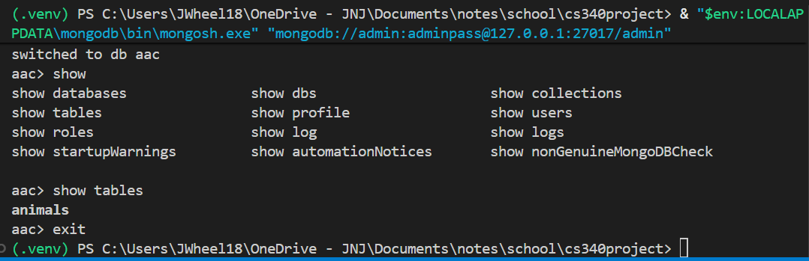
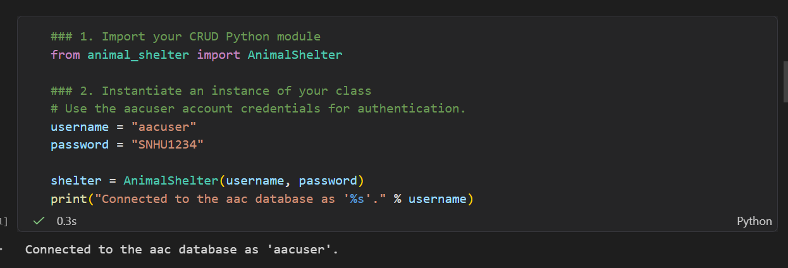
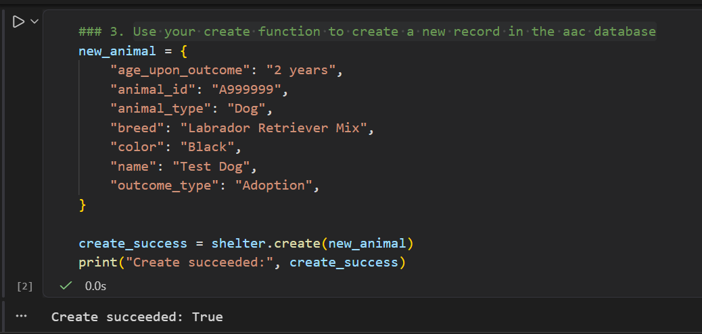
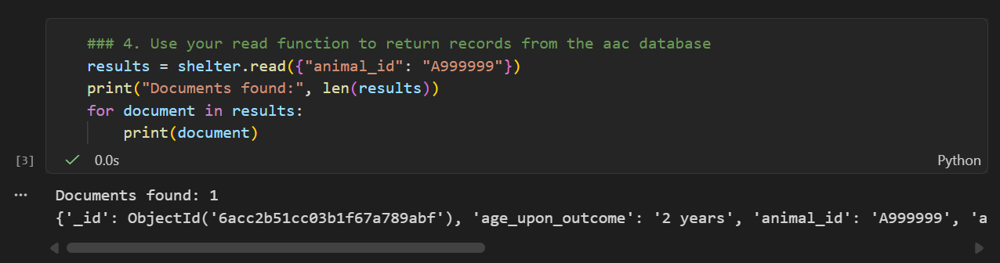
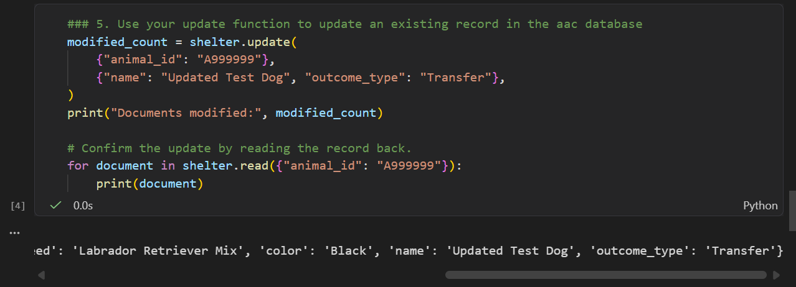
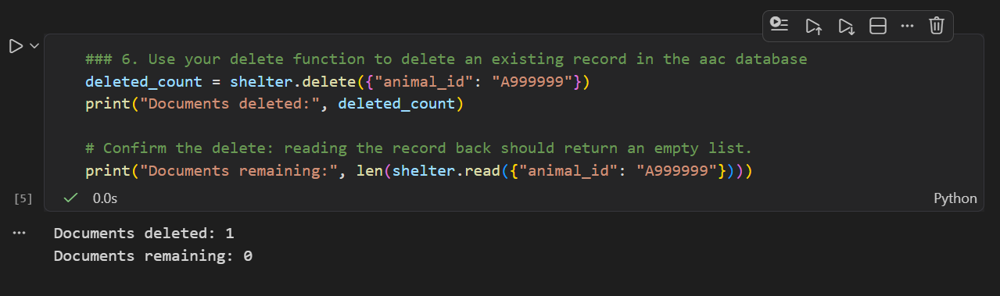

# Grazioso Salvare CRUD Module (CS-340 Project One)

## Purpose
A Python module (`animal_shelter.py`) that connects to the `aac` MongoDB database and
provides Create, Read, Update, and Delete (CRUD) operations on the `animals` collection.
It's written as a reusable class so other scripts (like the test notebook) can import it.

## How to Use It
Driver: **PyMongo** — the official MongoDB driver for Python. I used it because it's the
standard driver, works with Python dictionaries, and already has the find/insert/update/delete
methods built in.

Import it and create an object with the `aacuser` login:
```python
from animal_shelter import AnimalShelter
shelter = AnimalShelter("aacuser", "SNHU1234")
```

### CRUD Operations
- **create(data)** – inserts one document (a dictionary). Returns `True` if it worked, else `False`.
- **read(query)** – runs `find()` on a key/value query and returns the matches as a list (empty list if none).
- **update(query, new_values)** – updates matching documents with `update_many()` and returns the number modified.
- **delete(query)** – removes matching documents with `delete_many()` and returns the number deleted.

Each method checks its input and uses try/except for error handling.

## Screenshots
**MongoDB import (mongoimport):**



**User authentication:**



**CRUD test execution:**




